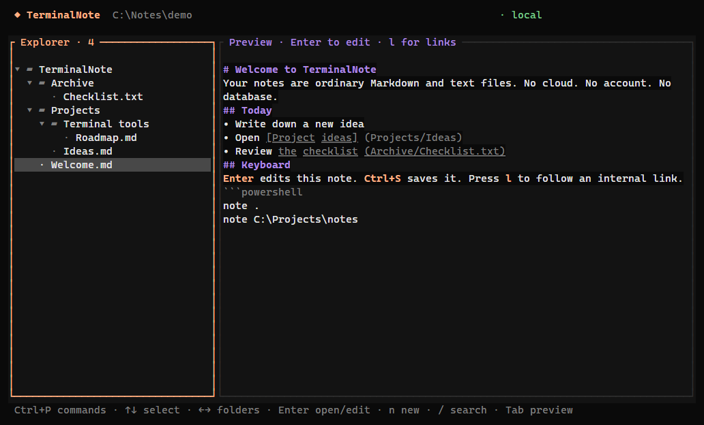
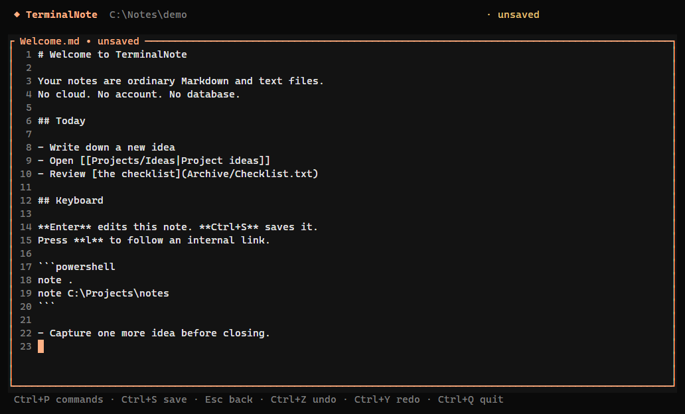
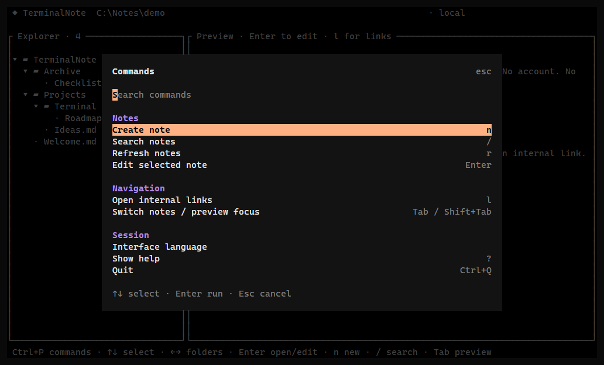

# TerminalNote

[](https://github.com/Andrey89711/TerminalNote/actions/workflows/ci.yml)
[CI/CD and draft releases](docs/RELEASING.md)

Local Markdown and plain-text notes in your terminal. A standalone Rust application
with the **`note`** command, not a plugin or part of OpenTerminal.
Source: [Andrey89711/TerminalNote](https://github.com/Andrey89711/TerminalNote).

Browse files, preview Markdown, edit notes and follow internal links. Notes stay
ordinary `.md` and `.txt` files: no cloud, account, database or encryption.
Windows installer packages and Linux binaries are available from
[GitHub Releases](https://github.com/Andrey89711/TerminalNote/releases/latest).

The TermVault-style interface uses dark panels, peach accents, purple headings and
muted labels. An Explorer-style expandable tree sits beside the preview. **Ctrl+P**
opens a centered command palette with a dimmed backdrop; compact gray notification
cards appear at the top right.



## Screenshots

### Editor

Full-screen source editing with line numbers and an unsaved-change indicator.
**Ctrl+S** saves; **Esc** returns to browsing.



### Command palette

Search available commands, select with the arrows and press **Enter**. The palette
is not a shell and does not insert its search text into a note.



Documentation screenshots use the actual Ratatui renderer with disposable demo
notes, not personal notes or configuration. Paths are sanitized for publication.

## Create a Markdown note

Press **n**, enter `Ideas.md` or just `Ideas`, then press **Enter**. The `.md`
extension is added automatically. For example:

````markdown
# Ideas

- First task
- Read [[Welcome]]

**An important thought** and [another note](Ideas.md).

```rust
println!("Hello, notes!");
```
````

**Ctrl+S** saves an ordinary Markdown file; **Esc** returns to the list and preview.
Specify `.txt` explicitly for a plain-text note.

## Windows installer

1. Download `terminalnote-v0.1.2-windows-x86_64.zip` and `SHA256SUMS.txt` from
   [the release page](https://github.com/Andrey89711/TerminalNote/releases/tag/v0.1.2).
2. Compare the ZIP's `Get-FileHash -Algorithm SHA256` result with the published checksum.
3. Extract the whole archive, then double-click **`setup.cmd`**. Do not run it from
   inside the ZIP. Rust and administrator permissions are not required.
4. Choose an existing notes folder, or explicitly confirm creating a new folder.
5. Open a new terminal and run **`note`**.

The installer uses `%LOCALAPPDATA%\Programs\TerminalNote`, adds the command to the
user PATH without replacing unrelated entries, and registers an Apps uninstall
entry. Reinstallation/repair keeps notes and the existing language setting.
Uninstall through Windows Settings → Apps → TerminalNote or `uninstall.cmd` in
the installed folder. **Notes and configuration are retained.** Unknown files in
the application directory are not recursively deleted.

The package is not code-signed. Windows may show a reputation warning: verify the
repository, release and checksum before choosing whether to run it. Checksums
detect mismatches; they are not digital signatures. The Windows x64 executable
links the C runtime statically, so no separate VC++ runtime package is required.

The same ZIP can also be used without installation: run `note.exe PATH_TO_NOTES`.
Linux users can extract the `.tar.gz` release and run `./note PATH_TO_NOTES`.

## Run from source

Requires Git and current stable [Rust](https://rustup.rs/).

```sh
git clone https://github.com/Andrey89711/TerminalNote.git
cd TerminalNote
cargo run -- examples/notes
cargo run -- --list examples/notes
cargo run -- --check examples/notes
```

The TUI needs an interactive terminal. `--list` and `--check` also work in scripts.

Install the command:

```sh
cargo install --path . --locked
```

This installs `note` (`note.exe` on Windows) into Cargo's bin directory, which must
be in `PATH`. To build locally without installing:

```powershell
cargo build --release --locked
.\target\release\note.exe .\examples\notes
```

After installation, select your own existing folder:

```powershell
note --set-default 'C:\Users\User\Notes'
note
note 'C:\Projects\my-project\notes'
```

## Commands

```sh
note                         # Open the configured folder; defaults to ~/Notes
note .                       # Open the current folder
note examples/notes          # Open a specific folder
note --init                  # Explicitly create the default folder and open the TUI
note --init ./my-notes       # Explicitly create a folder and open the TUI
note --set-default ./my-notes # Save an existing default folder and exit
note --list examples/notes   # List notes without the TUI
note --check examples/notes  # Check readability and internal links
```

Without `--init`, missing note folders are not created automatically.
`--set-default` also requires an existing folder: create it yourself or use `--init`
first. Relative command paths resolve against the current working directory.
`--check` exits with a nonzero status for errors, including broken internal links.

## Keys

### Browsing

| Key | Action |
| --- | --- |
| ↑ / ↓ | Select a folder or note |
| ← / → | Collapse / expand; move to parent / first child |
| Enter | Expand/collapse a folder or edit a note |
| Ctrl+P | Open/close the command palette; search English or Russian keywords |
| Tab | Switch focus between navigation and preview |
| Page Up / Page Down | Scroll preview |
| ↑ / ↓ with preview focus | Scroll preview |
| `n` | Enter a new note name |
| `/` | Filter filenames |
| `l` | Open internal links; Enter follows the selection |
| Alt+← | Go back after following a link |
| `r` | Reload notes from disk |
| `q` / Ctrl+Q | Quit |
| `?` | Open help; Enter/Esc returns to the previous screen |

### Editor and dialogs

| Key | Action |
| --- | --- |
| Ctrl+S | Save |
| Esc | Return to browsing |
| Ctrl+Q | Quit, confirming unsaved changes |
| Ctrl+Z / Ctrl+Y | Undo / redo |
| `s` / `d` / `c` in the unsaved-changes dialog | Save / discard / cancel |
| Enter when creating a note | Validate the name and create; `.md` is added automatically |
| Esc when creating a note | Cancel |

New notes default to the selected folder or the selected file's parent. The path
is prefilled and can be changed before creation. Creating notes does not create
parent folders. Folder creation, renaming and deletion are not supported; use a
file manager or terminal. TermVault's encryption, vault deletion and master-password
commands do not apply to these plain files.

The palette lists actions available on the current screen: create, find, edit,
save, undo/redo, links, back, reload, focus, language, help and quit. Use ↑/↓ to
select, Enter or a click to run, and Esc to cancel. Leaving the editor or quitting
still requires a decision about unsaved changes.

Click folders to expand/collapse and notes to preview; Enter opens the editor.
The mouse wheel scrolls navigation or preview. Terminal text selection while mouse
capture is enabled usually requires holding Shift.

The editor supports arrows, Home/End, Delete/Backspace and Shift selection. Paste
using your terminal's paste action (for example Ctrl+Shift+V). Bracketed paste is
supported; pasted text is never executed as commands. The app does not read the
system clipboard itself. Ctrl+S/Q/Z/Y/P also recognize the corresponding standard
Russian keyboard characters. Single-letter commands and confirmations use the EN layout.

## Files, links and limits

- The tree is derived from discovered `.md`/`.txt` files; folders without supported
  notes are not shown. The root can be collapsed. `/` shows flat full-relative-path
  search results, including notes in collapsed folders. Link navigation expands ancestors.
- Traversal is limited to 16 levels and 10,000 directory entries total, counting
  folders, files of every extension and skipped entries. A warning indicates truncation.
  The truncated subset depends on filesystem enumeration order; results are then sorted.
  `--list` still prints a plain relative-path list.
- `.git`, `.hg`, `.svn`, `target`, `node_modules` and symbolic links are skipped.
- UTF-8 `.md` and `.txt` files up to 2 MiB are supported, including UTF-8 BOM and CRLF.
- Internal links include `[[Ideas]]` and `[checklist](Archive/Checklist.txt)`.
  See [`examples/notes`](examples/notes).
- Basic Markdown preview supports headings, lists and code blocks. It does not
  download images or execute HTML or commands from notes.

Wiki links support labels: `[[Ideas|My ideas]]`. Press `l`, select a link with the
arrows and press Enter. Resolution tries a sibling note, then a root-relative path
or a unique filename elsewhere. Ambiguous links fail: specify the folder and
extension. `../` is allowed only within the root. External URLs, images and links
inside code are not opened. Heading navigation and `%20` decoding are not implemented;
use wiki links for names containing spaces. File-link anchors do not change scroll position.

Leaving the editor with unsaved changes requires saving, discarding or continuing
to edit. Saves use a temporary file in the same folder and atomic replacement.
External changes are detected by comparing the original bytes. On conflict, the
draft stays in the editor and no forced overwrite is offered. This is an optimistic
check, not a lock: another process can still change the file between checking and
replacement. Keep independent backups.

UTF-8 BOM and consistent CRLF are preserved; mixed LF/CRLF is normalized to LF on
save. Files containing control characters can be previewed safely, but the editor
refuses to modify them. There is no autosave or crash recovery. Press `r` to reload
external changes; there is no filesystem watcher. Filenames follow portable Windows rules.

Preview is limited to the first 256 KiB / 4,096 source lines, with a visible
truncation notice; the file itself is not truncated. The editor loads the full file
up to 2 MiB but refuses files over 50,000 lines; use an external editor for those.
Notes cannot be created in excluded folders or beyond the traversal depth limit.

## Language and settings

The TUI defaults to **English**. Open **Ctrl+P → Interface language**, then choose **English**
or **Russian (Русский)**. The choice persists across restarts; CLI output and documentation
remain English. Changing language preserves the configured notes root.
Note contents, filenames, link labels and operating-system diagnostics retain
their original text; switching language does not translate or rewrite your files.

`terminalnote/config.toml` lives in the user configuration directory provided by
`dirs`: usually `%APPDATA%` on Windows, `$XDG_CONFIG_HOME` or `~/.config` on Linux,
and `~/Library/Application Support` on macOS.

Supported settings are the optional absolute `root` path and `language` (`en` or `ru`):

```toml
root = '/home/user/Notes'
language = 'en'
```

On Windows, literal TOML strings are convenient: `root = 'C:\Users\User\Notes'`.
Prefer `note --set-default PATH`: it validates and canonicalizes the path and
writes atomically through a temporary file in the same folder, preserving language.

Without `root`, the default is `~/Notes`; without `language`, it is English.
Malformed TOML, unknown fields, invalid language values, non-string or relative
roots, non-UTF-8, files larger than 64 KiB and configuration symlinks are rejected.
Damaged configuration is not silently overwritten: fix it manually. The notes
folder's existence and accessibility are checked when opening it.

## Manual in-app updates

Use **Ctrl+P → Check for updates**. A separate consent dialog explains the request
before it starts; Esc cancels. GitHub receives your IP address and a
`TerminalNote/<version>` User-Agent. No note text, filenames, root paths or
configuration are sent. The request uses HTTPS with redirects disabled, a 64 KiB
response limit and a 10-second timeout.

There are no startup or scheduled checks. The background result never interrupts
an editor draft. Open **Update check result** through Ctrl+P, then Enter to review
the separate **download consent**. On Windows x86_64 this downloads only a newer
stable `terminalnote-vX.Y.Z-windows-x86_64.zip` and `SHA256SUMS.txt` from
`Andrey89711/TerminalNote`. GitHub and its `release-assets.githubusercontent.com`
download service receive your IP and app/version, never notes or settings.
Every HTTPS redirect is checked; archive downloads are bounded to 64 MiB and
90 seconds per request. SHA256, the exact package file list, regular-file types,
CRC, expanded sizes and compression ratios are checked before staging.

**Packages are unsigned. Checksums from the same GitHub release detect corruption,
not publisher authenticity or a compromised release account.**

After verification, open the result again and review the separate **install and
restart consent**. Small windows cannot accept a truncated confirmation.
Unsaved notes still require Save/Discard; Cancel keeps the draft.
Only after consent does the app run the staged executable's version probe and
launch a local copy of the current executable as its native Windows helper.
No PowerShell or downloaded installer script executes.

The helper runs without administrator rights from a current-user-owned stage in
Local AppData, rejects symlinks/junctions and unowned targets, binds the exact
running executable to its PID, and waits for exit before replacing `note.exe`.
It retries locked files for 30 seconds, writes the complete replacement before
moving the original, and rolls back a failed replacement. Restart preserves the
original arguments and working directory. Notes, configuration, language, PATH,
installer scripts/ownership metadata, documentation and unknown files are not
modified. This is an **executable-only update**, not a full installer upgrade.
Existing installation ownership markers are validated but retained unchanged.
Use the normal release installer if you also want updated installer/support files.

Downloaded stages are removed when cancelled/closed before installation. Once
handed to the helper, `terminalnote-update-*` stages remain in Local AppData for
diagnosis (including a local plan containing executable path/launch arguments);
they can be removed after the helper exits. Installation is supported only on
Windows x86_64 with a writable, current-user-owned `note.exe` and program folder.
Other platforms explicitly decline installation; metadata checks remain available.
Install the first version containing this updater once using `setup.cmd`;
earlier versions can only check for updates and open the release page.

## Development and CI/CD

```sh
cargo fmt --all -- --check
cargo check --locked --all-targets
cargo clippy --locked --all-targets -- -D warnings
cargo test --locked --all-targets
cargo build --locked --release
```

CI checks formatting, compilation, Clippy and tests on Windows and Linux with stable
Rust. Configuration tests use temporary directories, never real user settings.
For isolated tests or demos, set `TERMINALNOTE_CONFIG` to an **absolute** path to
a separate `config.toml`; relative overrides are rejected. Without this override,
the normal platform configuration location is unchanged. PTY tests use isolated
settings rather than your real configuration.
The hidden `--config-file ABSOLUTE_PATH` option explicitly selects an isolated
configuration file and takes precedence over the environment. PTY tests use this
argument because ConPTY environment forwarding can vary between Windows setups.
See [release notes and packaging](docs/RELEASING.md) for tag-triggered Windows
static-CRT and Linux archives, checksums and manual draft-release approval.
There is no automatic public publication; editing documentation does not create a
tag, push commits or publish a new version.

To refresh screenshots on Windows (Rust and Microsoft Edge required):

```powershell
pwsh -NoProfile -File scripts/capture-docs.ps1
```

Without Edge, generate SVG files in `docs/images`:

```sh
cargo test --locked capture_documentation -- --ignored
```

Screenshot generation is opt-in; ordinary tests do not overwrite images.

## License

[MIT](LICENSE), © 2026 Andrey89711.
